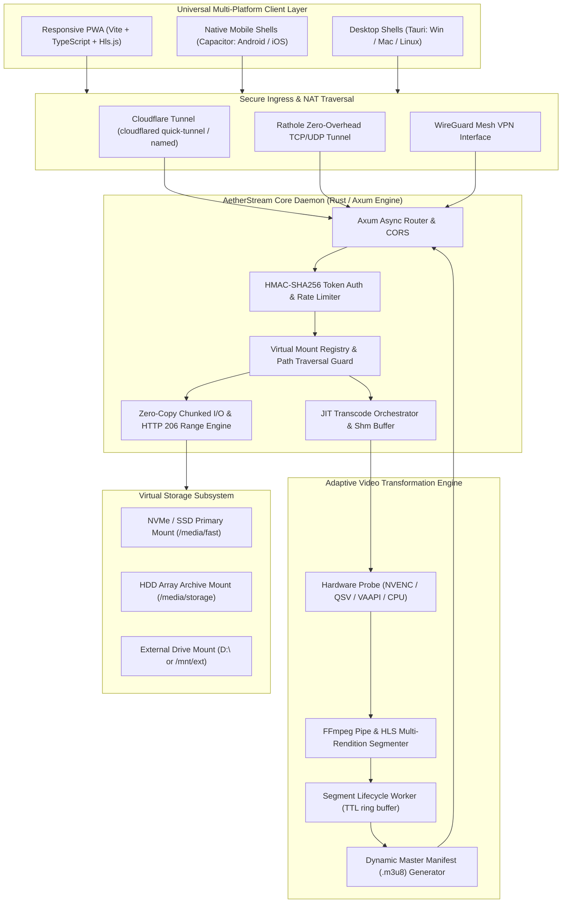
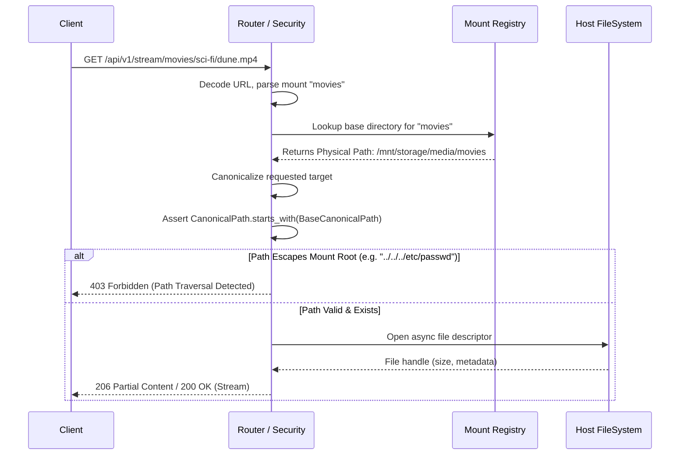
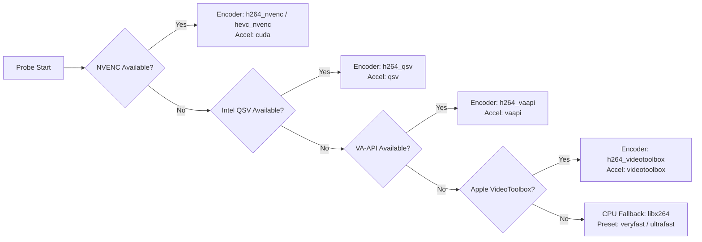
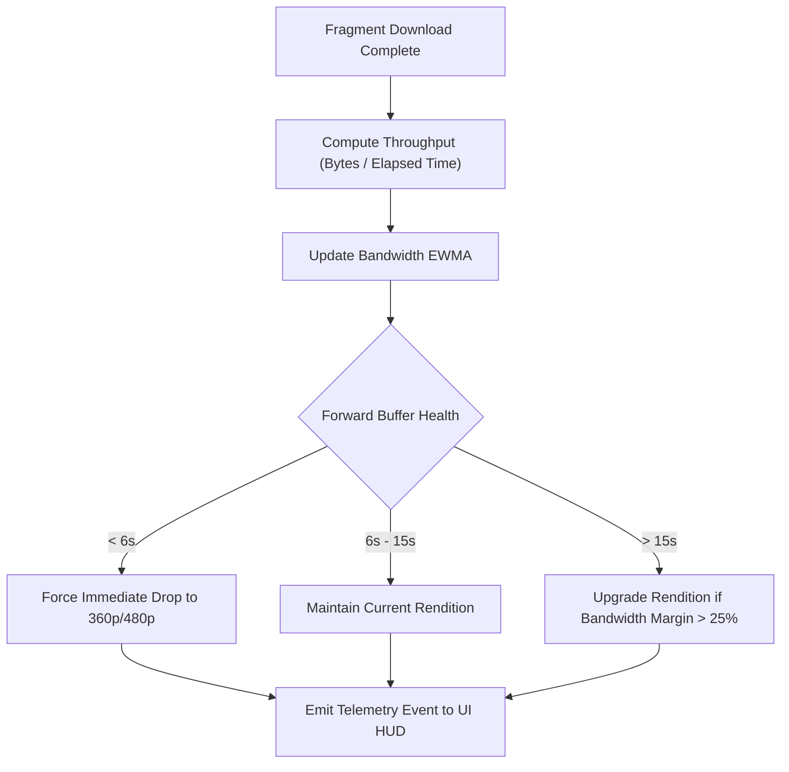
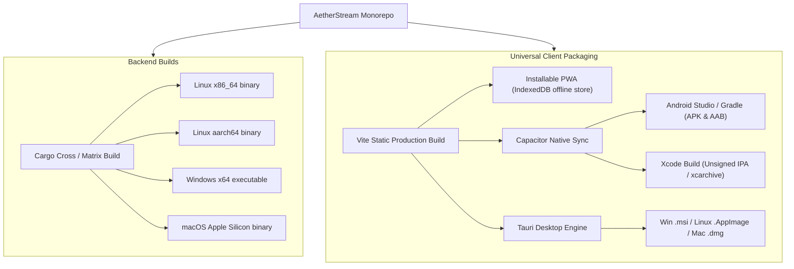

# SYSTEM ARCHITECTURE SPECIFICATION
**System:** AetherStream (Distributed Media Streaming & Virtual Storage Architecture)  
**Classification:** Production High-Throughput Specification  
**Architecture Revision:** 1.0.0  

---

## 1. END-TO-END ARCHITECTURAL OVERVIEW

AetherStream decouples high-performance asynchronous storage I/O, on-demand hardware-accelerated video transformation, zero-config secure edge tunneling, and an adaptive universal client platform.



---

## 2. HOST ENGINE & STORAGE SUBSYSTEM (RUST + AXUM)

### 2.1 Concurrency Model & Async Reactor
The daemon runs on top of `tokio` multi-threaded runtime with asynchronous worker pools:
- **I/O Reactor:** Uses OS epoll / kqueue / IOCP to handle thousands of concurrent client connections with minimal context-switch overhead.
- **Worker Affinity:** File reads are scheduled onto `tokio::task::spawn_blocking` pools to prevent blocking reactor event loops on synchronous disk subsystem bottlenecks.
- **Zero-Copy Streaming:** Direct streaming utilizes `tokio_util::io::ReaderStream` wrapping async OS file handles, bypassing intermediate heap allocations via chunked transfer framing (`axum::body::Body`).

### 2.2 Path Sanitization & Virtual Mount Registry
Every virtual mount maps an external label (e.g. `movies`, `music`, `vault`) to a physical OS path.


### 2.3 HTTP 206 Range Request Engine
- Supports standard RFC 7233 range headers: `Range: bytes=start-end`.
- Handles single-range requests with precise byte-level slicing:
  $$\text{Content-Range: bytes } s - e / \text{total}$$
- Automatically defaults to initial burst chunks ($2\text{ MiB}$) if the client omits the trailing range parameter (`Range: bytes=0-`), optimizing instant playback start while preventing unbounded disk read queues.

---

## 3. ADAPTIVE BITRATE TRANSCODE PIPELINE (FFMPEG JIT)

### 3.1 Hardware Acceleration Detection & Probe Matrix
On server boot and during runtime transcoding initialization, the engine executes a rapid capability probe:



### 3.2 JIT HLS Segmenter Architecture
1. **Source Discovery:** Media probe analyzes video/audio codecs, resolution, bitrate, and keyframe intervals using `ffprobe` JSON stream metadata.
2. **Dynamic Subprocess Pipe:** If the source codec is already browser-compatible (`H.264` + `AAC`) and resolution matches client capabilities, the engine engages **Direct Stream Mode** (zero transcoding CPU overhead).
3. **On-Demand Transcoding Ladder:** If adaptation is requested, FFmpeg is spawned as an async child process outputting segment slices (`.ts`) and variant manifests to a fast in-memory or ephemeral scratch ring buffer:
   - Fragment Duration: $4.0\text{ seconds}$
   - Keyframe interval (`GOP`): $2.0 \times \text{FPS}$ (e.g., GOP=60 for 30fps)
   - Master playlist (`master.m3u8`) links all profiles:
     ```m3u8
     #EXTM3U
     #EXT-X-VERSION:6
     #EXT-X-STREAM-INF:BANDWIDTH=4500000,RESOLUTION=1920x1080,CODECS="avc1.640028,mp4a.40.2"
     1080p/index.m3u8
     #EXT-X-STREAM-INF:BANDWIDTH=2500000,RESOLUTION=1280x720,CODECS="avc1.4d401f,mp4a.40.2"
     720p/index.m3u8
     #EXT-X-STREAM-INF:BANDWIDTH=1200000,RESOLUTION=854x480,CODECS="avc1.4d401e,mp4a.40.2"
     480p/index.m3u8
     #EXT-X-STREAM-INF:BANDWIDTH=600000,RESOLUTION=640x360,CODECS="avc1.42e01e,mp4a.40.2"
     360p/index.m3u8
     ```
4. **Segment Cleanup Worker:** Background Tokio task evicts segments older than $60\text{ seconds}$ once elapsed playback horizons move forward, capping disk consumption per active stream to $< 50\text{ MB}$.

---

## 4. CLIENT-SIDE BUFFER & TELEMETRY ENGINE (HLS.JS + PWA)

### 4.1 Adaptive Bitrate Controller
The client integrates custom ABR algorithms with `hls.js`:
- **Bandwidth Moving Average:** Exponential Weighted Moving Average (EWMA) calculated over the last 5 downloaded fragments.
- **Buffer Starvation Avoidance:** If forward buffer falls below $6.0\text{ seconds}$, switch instantly to lower rendition without waiting for standard playlist switch heuristics.
- **Max Buffer Ahead:** Configured to $30.0\text{ seconds}$ to conserve memory on mobile devices and reduce unconsumed stream waste.



---

## 5. REMOTE CONNECTIVITY & ZERO-CONFIG NAT TRAVERSAL

Three complementary egress layers ensure access without public IPv4 or port forwarding:
1. **Cloudflare Tunnel (`cloudflared`):**
   - Direct encrypted outbound HTTPS tunnel to Cloudflare Edge.
   - Built-in TLS termination and HTTP/2 multiplexing.
   - Zero open router ports, resistant to ISP CGNAT.
2. **Rathole Tunnel:**
   - Lightweight zero-overhead Rust-based tunnel (`rathole`) for VPS egress.
   - Supports multiplexed TCP/UDP with Noise protocol encryption.
3. **Embedded WireGuard:**
   - Peer-to-peer authenticated VPN mesh for low-latency direct connectivity.

---

## 6. CROSS-PLATFORM BUILD STRATEGY



---

## 7. DATA ENCRYPTION & TOKEN AUTHORIZATION SPECIFICATION

### 7.1 Scoped HMAC Token Format
Access to media files and dynamic transcode streams is validated by high-speed HMAC-SHA256 signatures:
$$\text{Token} = \text{Base64URL}(\text{MountID} \mathbin{\Vert} \text{RelativePath} \mathbin{\Vert} \text{ExpiryTimestamp} \mathbin{\Vert} \text{Permissions} \mathbin{\Vert} \text{HMAC}(\text{Secret}, \dots))$$

- **Time-To-Live (TTL):** Configurable from 15 minutes (ephemeral share links) to 30 days (authenticated device sessions).
- **Scope Restriction:** Tokens are strictly bound to a designated mount and subpath. A token issued for `/movies/comedy` cannot access `/movies/action` or any other virtual mount.
- **Revocation List:** In-memory Bloom filter + SQLite persistence for instantaneous revocation of compromised share links.
