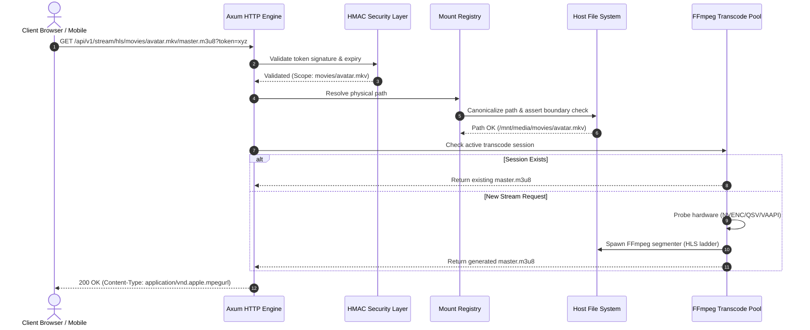

# CODEBASE UNDERSTANDING & ONBOARDING GUIDE
**System:** AetherStream Ecosystem  
**Target Audience:** Core Contributors, Systems Engineers, AI Agents  
**Revision:** 1.0.0  

---

## 1. WORKSPACE TOPOGRAPHY & REPOSITORY LAYOUT

```
aetherstream/
│
├── .github/
│   └── workflows/
│       ├── build-and-release.yml    # CI Matrix & Mobile Artifact Distribution
│       └── ci.yml                   # Automated linting, test suite, and security scan
│
├── .githooks/
│   └── pre-commit                   # Enforces append-only logs & format verification
│
├── bootstrap.ps1                    # Master PowerShell orchestrator & step runner
├── state.tracker.json               # Central immutable stage/phase tracker
│
├── CONTRACT.md                      # Production engineering rules & non-negotiable SLAs
├── ARCHITECTURE.md                  # Deep technical specification & mermaid topology
├── REQUIREMENTS.md                  # Functional and non-functional requirements
├── CODE_UNDERSTANDING.md            # Directory layouts, data flows, thread models
├── CHANGELOG.md                     # Strictly append-only historical audit ledger
├── TODO.md                          # Strictly append-only task and execution ledger
├── SKILLS.md                        # Agent behavioral patterns and capabilities
├── RULES.md                         # Rules of engagement & commit policies
│
├── scripts/                         # Modular PowerShell automation suite
│   ├── common.ps1                   # Shared state management & validation utilities
│   └── stages/
│       ├── stage-1.ps1              # Workspace, infra & governance verification
│       ├── stage-2.ps1              # Storage & I/O engine verification
│       ├── stage-3.ps1              # Video transcode pipeline verification
│       ├── stage-4.ps1              # Universal client & mobile shells
│       ├── stage-5.ps1              # Remote connectivity & secure tunnels
│       └── stage-6.ps1              # CI/CD and release pipelines
│
├── crates/                          # Rust Backend Workspace
│   └── server/
│       ├── Cargo.toml               # Engine dependencies & compiler profiles
│       └── src/
│           ├── main.rs              # Application entrypoint & Axum router assembly
│           ├── config.rs            # Declarative environment & mount configs
│           ├── storage/
│           │   ├── mod.rs
│           │   ├── mounts.rs        # Virtual mount registry & traversal security
│           │   └── stream.rs        # HTTP 206 Range requests & chunked zero-copy
│           ├── transcode/
│           │   ├── mod.rs
│           │   ├── profiles.rs      # ABR profiles (1080p, 720p, 480p, 360p)
│           │   └── pipeline.rs      # FFmpeg probe, JIT segmenter & sweeper
│           └── security/
│               ├── mod.rs
│               └── hmac_auth.rs     # Scoped token generation & validation
│
├── client/                          # Universal Multi-Platform Client (Vite + TS)
│   ├── index.html                   # HTML5 Entrypoint with PWA shell
│   ├── package.json                 # Client dependencies (hls.js, lucide, vite)
│   ├── vite.config.ts               # Vite configuration with PWA headers
│   ├── capacitor.config.ts          # Android/iOS native runtime config
│   ├── src/
│   │   ├── main.ts                  # App bootstrapper & DOM mount
│   │   ├── app.css                  # High-performance zero-dependency stylesheet
│   │   ├── components/
│   │   │   ├── FileExplorer.ts      # Virtual filesystem directory browser
│   │   │   ├── VideoPlayer.ts       # Hls.js video player with live telemetry HUD
│   │   │   └── ShareModal.ts        # Scoped HMAC link generation interface
│   │   └── services/
│   │       └── api.ts               # Resilient HTTP & streaming client
│   └── src-tauri/
│       └── tauri.conf.json          # Windows, macOS & Linux desktop shell config
│
└── config/                          # Tunnel & Deployment Configurations
    ├── mounts.example.json          # Sample storage mount declarations
    └── tunnel/
        ├── cloudflared.yml          # Cloudflare Tunnel ingress configuration
        ├── rathole-server.toml      # Rathole relay server specification
        ├── rathole-client.toml      # Rathole local client configuration
        └── wireguard-peer.conf      # WireGuard point-to-point interface
```

---

## 2. THREAD MODEL & LIFECYCLE FLOW

### 2.1 Rust Engine Asynchronous Execution Model
The server utilizes an asynchronous, actor-inspired architecture:
1. **Tokio Core Threadpool:** Processes network events, TLS handshakes, HTTP parsing, and JSON serialization. Default thread pool size equals available CPU cores.
2. **Blocking I/O Threadpool:** When streaming physical files or scanning large directory hierarchies, execution delegates to `tokio::task::spawn_blocking` to avoid stalling network polling threads.
3. **Subprocess Management Worker:** When on-demand transcoding is required, FFmpeg instances run as asynchronous child processes (`tokio::process::Command`), communicating via non-blocking pipes for status events while segment output is written to memory-mapped or fast SSD scratch directories.
4. **Housekeeper Actor:** A periodic timer loop triggers every 30 seconds to clean expired transcode segments and purge inactive session memory.



---

## 3. DEVELOPER & CONTRIBUTOR CONVENTIONS

### 3.1 Rust Engine Standards
- Run `cargo fmt --all --check` and `cargo clippy --all-targets -- -D warnings` prior to any PR.
- Never use `.unwrap()` or `.expect()` in non-test paths. All errors must map into strongly-typed `AppError` enums returning standardized JSON error envelopes.
- All file reads for HTTP range requests must use `tokio::io::AsyncSeekExt` and `tokio::io::AsyncReadExt` with chunk size bounded between $64\text{ KiB}$ and $2\text{ MiB}$.

### 3.2 Client (Vite + TypeScript) Standards
- Zero bloated heavy UI dependencies. Clean, accessible, semantic DOM structure with CSS custom properties for theming.
- Handle all network disconnections gracefully with exponential backoff retries.
- Maintain strict typing with TypeScript `strict: true`.

### 3.3 State & Script Conventions
- Always invoke stages via `.\bootstrap.ps1 -Interactive` or `.\bootstrap.ps1 -RunNext`.
- Direct manual edits to `state.tracker.json` are forbidden; transitions must execute via `scripts/common.ps1` helper cmdlets.
- All log appends must be non-destructive.
